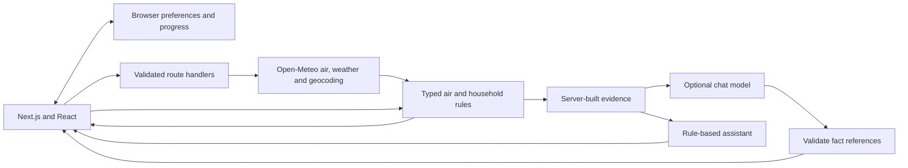

# VayuGuard AI

**Breathe Better. Live Smarter.** VayuGuard turns a city air-quality forecast into decisions a household can make today. A family in Jaipur can check whether a morning run fits the forecast, plan around a fixed school drop-off and estimate the difference between driving and taking a bus.

**Aeris** is the repository for this Virtual Prompt Wars entry. The selected vertical is family and community urban air pollution assistance.

> Create a GenAI-powered assistant that helps families and communities navigate severe winter smog and urban air pollution. The application should suggest low-emission daily routines, indoor air quality hacks, and sustainable alternatives tailored to their location and lifestyle, while clearly explaining the direct impact of their choices.

## Run locally

Use Node.js 24 LTS and npm. No credentials are required for environmental data or the rule-based assistant.

```sh
git clone https://github.com/Ayansh-70/Aeris.git
cd Aeris
npm ci
npm run dev
```

Open [localhost:3000](http://localhost:3000). Choose **Set up my household**, select a city, then save your household, routine and goals. The header switches between live mode and a labeled sample. With dependencies installed and the local server running, the sample works offline. The sample represents one fixed illustrative winter day, including when you change cities.

### Enable GenAI

Copy `.env.example` to `.env.local`, set the following server variables and restart the server. Each assistant answer identifies the mode that produced it.

| Variable | Use |
| --- | --- |
| `OPENAI_API_KEY` | Authenticates the server to the model provider. |
| `OPENAI_MODEL` | Recommended explicit chat model available to your account. With an empty value the adapter attempts model discovery. |
| `OPENAI_BASE_URL` | Optional compatible API base, including its version path. Defaults to the OpenAI v1 endpoint. |

The provider must support Chat Completions with JSON-object output. The model interprets the question and conversational context, chooses relevant facts, and arranges them as an answer, explanation and next action. The server resolves those references into household-specific guidance. Unknown references, repeated facts, invalid output and provider failures trigger a clearly labeled rule-based reply. This constrained generation trades some conversational flexibility for traceable claims.

## What you can do

| Screen | Decision or action |
| --- | --- |
| Overview and setup | Preview local conditions. Pick a city, search globally or request device location. Choose a family, commuter or organizer profile. |
| Air dashboard | Inspect the modeled US AQI, pollutant concentrations, weather, hourly trend, personal priorities and completed plan actions. Use the slider to inspect individual forecast hours. |
| Vayu assistant | Ask which outdoor activity, trip or indoor intervention fits your household. Short follow-ups can use the recent conversation. |
| Daily planner | Generate a schedule around wake-up, departure and finish times. Save a plan, complete steps and reset daily progress. |
| Indoor air | Prioritize cooking ventilation, source control, wet cleaning or filtration according to outdoor conditions, available equipment and budget. |
| Transport and impact | Compare eight modes, change trip frequency and carpool occupancy, and inspect the formula and its factors. |
| What-if lab | Switch a subset of trips, compare two forecast hours or explore removing an indoor combustion source. |
| Community | Join challenges, log action-days, copy a summary and model a hypothetical group transit switch. Participation records are local to this browser. |
| Settings | Edit preferences, switch data mode or clear VayuGuard’s local records. |

## How the application makes decisions



- **Air quality.** The provider’s US AQI uses six AirNow categories with upper bounds of 50, 100, 150, 200, 300 and an open-ended hazardous band. A missing index stays unavailable. Readings older than three hours or more than one hour ahead of the current clock are excluded from current-condition guidance. Indian cities use the same US index. India’s National AQI has a different methodology. [AirNow AQI basics](https://www.airnow.gov/aqi/aqi-basics/)
- **Priority.** Unknown current conditions, US AQI above 150, or above 100 in a sensitive household put activity guidance first. Other actions receive deterministic scores for persona, exposure and emissions goals, and affordability. Each action carries a rationale, expected benefit, cost, effort and evidence classification.
- **Schedule.** The planner preserves fixed commitments and considers remaining forecast hours in the selected city’s time zone. A conservative scheduling rule requires US AQI at or below 50 for sensitive households or 100 otherwise before suggesting outdoor exercise. It offers an indoor alternative when conditions or scheduling make a suitable hour unavailable. These are product planning cutoffs. Check official local advisories and individual clinical guidance for personal health decisions. [AirNow particle pollution guidance](https://document.airnow.gov/air-quality-guide-for-particle-pollution.pdf)
- **Indoor air.** Advice accounts for local outdoor particles, cooking, available exhaust and filtration, sensitive members and budget. Outdoor models cannot tell whether a particular room is clean or adequately ventilated. [EPA clean-room guidance](https://www.epa.gov/emergencies-iaq/create-clean-room-protect-indoor-air-quality-during-wildfire)

### Emission estimates

**kg CO₂e per passenger = one-way distance in km × one-way trips × kg CO₂e per passenger-km.** For a partial switch, unchanged trips keep the baseline factor. Multiply the per-person difference by an explicitly hypothetical participant count for a group scenario.

| Mode | Factor | Assumption |
| --- | ---: | --- |
| Car | 0.16272 | Average petrol car, solo |
| Carpool | 0.16272 ÷ occupants | 2–8 passengers including the driver |
| Motorcycle | 0.11367 | Average motorcycle, solo |
| Bus | 0.10385 | Average local bus passenger-km |
| Rail | 0.03546 | National rail passenger-km used as a proxy |
| Walk, cycle, remote | 0 | Direct operational trip emissions |

For ten one-way trips of 10 km, solo car travel gives **16.272 kg CO₂e**, bus travel gives **10.385 kg**, and the estimated difference is **5.887 kg per passenger per week**. UK fleet averages are proxies for local travel. Actual occupancy, fuel, detours and electricity mix vary. The estimates exclude vehicle production, upstream energy and extra home energy for remote work. A greenhouse-gas difference does not quantify an individual’s particle exposure or a citywide AQI change. [DESNZ 2025 conversion factors, Business travel – land](https://www.gov.uk/government/publications/greenhouse-gas-reporting-conversion-factors-2025)

## Data and architecture

The App Router serves React screens, TypeScript route handlers and a shared domain library. Tailwind CSS, local styles and Lucide provide the interface. Responsive SVG and native range controls keep charts lightweight and keyboard accessible. All application data requests use same-origin routes.

| Route | Purpose |
| --- | --- |
| `GET /api/geocode?q=Jaipur` | Validated city results from GeoNames through Open-Meteo. [Geocoding API](https://open-meteo.com/en/docs/geocoding-api) |
| `GET /api/air-quality?latitude=26.91&longitude=75.79&mode=live` | Current modeled US AQI, pollutant subindices and up to 24 hourly forecast values. PM2.5, PM10, NO₂, O₃, CO and SO₂ concentrations use µg/m³. Missing values remain missing. [Open-Meteo Air Quality API and CAMS attribution](https://open-meteo.com/en/docs/air-quality-api) |
| Same air-quality route | Weather enrichment includes temperature in °C, relative humidity in percent and wind in km/h. Weather failure can leave pollutant data available. [Open-Meteo Forecast API](https://open-meteo.com/en/docs) |
| `POST /api/recommendations` | Accepts a validated profile and data mode and derives contextual actions. |
| `POST /api/chat` | Accepts a profile, mode, message and limited history. Retrieves its own environmental context. Supports compatible Chat Completions and optional model discovery. |

`lib/domain/` owns the schemas, US AQI interpretation, scoring, schedules and calculations. `lib/server/` owns network adapters, normalization, cache and assistant evidence. `components/features/` holds the household workflows. `tests/` contains domain, provider, API and browser journey checks.

## Privacy, reliability and access

Profiles and saved progress live in browser storage. Location is optional and can be selected manually. The server rounds upstream coordinates to two decimal places. Relevant household context and the conversation are sent to the configured model provider for AI-assisted answers. Avoid personal identifiers in questions. The application has no account database or cross-device sync.

Validated requests and bounded response streams limit payload size. Chat allows an 800-character question, up to six history turns and a 16 KiB request body. The provider gets an 18-second response timeout and a 32 KiB response limit. Plain-text React rendering and validated evidence references keep model output out of executable contexts. Each server process allows 20 chat requests per minute across users. Multi-instance deployments need shared gateway limits for a global spend limit.

Air requests share a bounded ten-minute cache and concurrent misses. Geocoding caches for one hour. Failures can be retried. Switching to sample data requires an explicit user action. Visible source labels, text severity categories, labeled controls, focus outlines, reduced-motion support and a mobile navigation menu support different viewing and input needs.

## Validation and deployment

```sh
npm run typecheck
npm run lint
npm test
npx playwright install chromium
npm run test:e2e
npm run build
npm start
```

The browser suite exercises desktop Chromium and an emulated Pixel 7. To use an installed Chrome, set `PLAYWRIGHT_CHROMIUM_EXECUTABLE` to its executable path. Tests cover onboarding, local persistence, plan actions, a chat exchange, transport mathematics, scenario controls, community participation and provider outage recovery. Service tests exercise successful and failing model responses with mocks.

Deploy to a Node.js host with `npm ci && npm run build` as its build command and `npm start` as its start command. Set the server environment variables in the host’s secret store. Serve over HTTPS for browser geolocation and clipboard support. Review Open-Meteo’s licensing for your deployment and provider billing before enabling public AI access. [Next.js deployment](https://nextjs.org/docs/app/getting-started/deploying) · [Open-Meteo pricing and use terms](https://open-meteo.com/en/pricing)

## Judge walkthrough · about four minutes

1. **First minute.** On Overview, enable **Sample Data** for a repeatable winter-smog scenario. Set up a Jaipur family with an older adult, a low budget and a 10 km car commute.
2. **Second minute.** On Air dashboard, inspect the timestamp and scrub the forecast. Open the assistant and ask “Should my parents take a morning walk?” Show the answer’s mode and its grounding.
3. **Third minute.** Open Daily planner, inspect the fixed commute, save the plan and complete one action. Open Indoor air and inspect a low-cost intervention and its rationale.
4. **Fourth minute.** In Impact calculator compare ten 10 km car trips with bus trips. Change the number of trips in What-if lab. Join Idle-free pickup, log today’s action, then return to the dashboard to see progress.

## Competition package and limits

- Public source repository on the single `main` branch. The source and Git history fit below the 10 MB competition limit. Dependencies, environment secrets, screenshots, browser traces and build output are excluded.
- Competition submission is a separate manual action. The project includes the code, setup and demo steps needed for judging.
- Outdoor readings are modeled, with spatial and temporal uncertainty. Household exposure, current street-level conditions, transit schedules and fares require additional local information.
- The UI is in English. Future work could add localized transport factors, translations and optional station observations with separate provenance.

